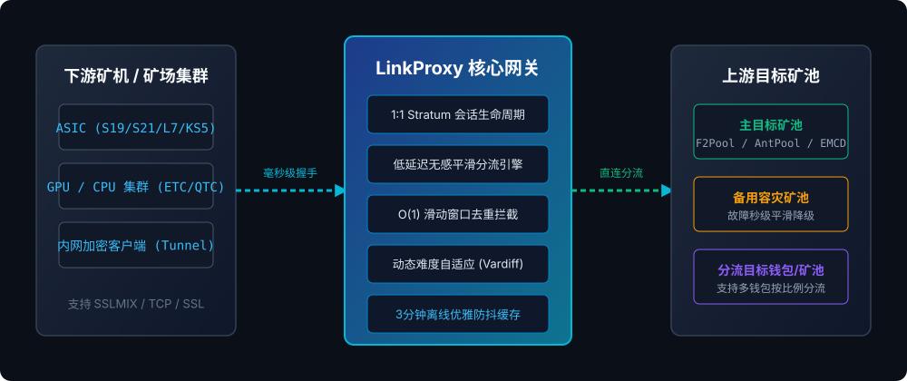

<div align="center">
  <a href="https://github.com/LinkProxy-Core/linkproxy">
    
  </a>

  <h1>LinkProxy</h1>

  <p>
    <strong>企业级高性能多币种 Stratum / EthProxy 网络分流与加密中转服务</strong>
  </p>

  <p>
    万台高并发 · 零漏报转发 · 毫秒级防抖 · 混淆加密中转 · 深度硬件兼容 (BTC / LTC / KAS / ETC / PRL / QTC)
  </p>

  <p align="center">
    <strong>简体中文</strong>
    ·
    <a href="README_EN.md">English</a>
    ·
    <a href="https://linkproxy-core.github.io/linkproxy/">在线手册 (中文)</a>
    ·
    <a href="https://linkproxy-core.github.io/linkproxy/#/en/">Online Manual (EN)</a>
  </p>

  <p>
    <a href="https://github.com/LinkProxy-Core/linkproxy/releases/latest"></a>
    <a href="https://linkproxy-core.github.io/linkproxy/"></a>
    
    
    
    <a href="README_EN.md"></a>
  </p>
</div>

---

## 🚀 系统架构与核心特性

LinkProxy 针对 BTC、LTC、Kaspa、ETC、PRL、QTC 等主流 ASIC 算力芯片与 GPU/CPU 计算集群开发，深度对齐底层 Stratum 协议会话生命周期与硬件状态机，提供高并发网关服务、动态难度自适应、零算力损失平滑分流与 Web 可视化管理。

<div align="center">
  
</div>

### 核心优势

- **严格 1:1 Stratum 会话纪律**：拒绝粗暴的多矿机复用上游连接，彻底杜绝 Extranonce 碰撞、芯片寄存器溢出与矿池拒绝率激增。
- **平滑切池无感分流**：基于逆向对齐的标准 10ms 步进同步机制，矿机在分流切换期间 **0 算力抖动、0 芯片重启、0 假死**。
- **O(1) 预判式重复份额拦截**：集成滑动窗口去重过滤引擎，在本地毫秒级截获并过滤无效/重复份额，保护矿机免遭矿池拉黑。
- **免配置加密中转隧道**：自带全景监控的双向控制信道与长连接管理引擎，支持客户端一键远程热重启与加密数据管道穿越。
- **3 分钟优雅离线防抖**：矿池瞬断或网络波动时，3 分钟内重连无缝迁移累积有效份额与历史折线图，杜绝僵尸矿机与频繁误报警。
- **端口参数一键深度克隆**：管理后台支持现有端口参数一键深拷贝，无需重复填写目标矿池、备用矿池与高级参数，秒级派生新端口。
- **大客户免抽水白名单**：支持精确至子账户/钱包的 O(1) 免抽白名单分流。

### 💡 为什么选择 LinkProxy？（对标传统代理）

针对传统矿机中转软件在实机运维中的历史硬伤，LinkProxy 进行了底层重构：

| 对比维度 | 传统中转软件 (minerProxy / 早期代理) | LinkProxy 企业级网关 |
| :--- | :--- | :--- |
| **会话复用** | 强行将多台矿机复用上游 Stratum 会话，易导致 Extranonce 碰撞与拒绝率飙升 | **严格 1:1 Stratum 独立会话**，每台矿机状态隔离，符合顶级矿池规范 |
| **切池与芯片稳定性** | 切池时粗暴注入 `clean_jobs`，引发蚂蚁 S19/S21 算力板复位与保护重启 | **10ms 步进平滑同步**，对齐硬件状态机，**0 算力抖动、0 芯片重启** |
| **重复份额过滤** | 本地无预判，原样转发至矿池，易导致矿池风控拉黑或显示无效份额 | **O(1) 滑动窗口拦截 (`RecentShareTracker`)**，本地毫秒级预判去重 |
| **网络闪断防抖** | 矿池或本地网络秒级断开即判定离线并重置数据，控制台频繁报警 | **3 分钟优雅离线防抖缓存**，断线平滑重连，无缝保留累积份额与折线图 |
| **跨国抗干扰** | 需额外安装第三方复杂代理，配置繁琐且易被运营商识别阻断 | **内置免配置双向加密隧道**，单文件客户端即开即用，抵抗 QoS 干扰 |
| **费率公开透明** | 部分老牌代理暗扣阶梯抽水高达 1%~3% | **全网统一 0.2% 极低费率**，个人免费，100% 透明公开 |
| **新算法与新币支持** | 仅支持传统老币，新币无法解析分流或算力折损 | 原生深度支持 **PRL (Pearlhash)**、**QTC (Quantus)**、**Kaspa** 等全系算法 |

---

## 📚 深度技术文档与运维手册

| 章节 | 文档说明 | 重点关注内容 |
| :--- | :--- | :--- |
| **[01. 快速上手指南](docs/01_quickstart.md)** | 安装部署与初始化 | 推荐硬件规格、Linux/Windows 部署、默认管理凭据 |
| **[02. 高并发系统调优](docs/02_linux_tuning.md)** | 万台矿机高并发参数手册 | 解除句柄限制 (1048576)、TCP 网络栈调优、BBR 拥塞控制 |
| **[03. 币种与矿池矩阵](docs/03_coins_and_pools.md)** | 15+ 种主流币种对接实践 | BTC/LTC/KAS/ETC/PRL/QTC 推荐端口与主备容灾模式 |
| **[04. 安全防护与生产加固](docs/04_security_defense.md)** | 防御加固与加密隧道 | 后台防爆破、IP 白名单、加密中转隧道、大客户免抽白名单 |
| **[05. 故障排查手册 (FAQ)](docs/05_faq_troubleshooting.md)** | 常见问题自检与排查 | 连不上排查、拒绝率偏高分析、管理员密码重置 |

> 📖 **官方在线完整手册**：[https://linkproxy-core.github.io/linkproxy/](https://linkproxy-core.github.io/linkproxy/)

---

## 📦 极速安装与部署

### 1. Linux 一键安装（推荐，支持 Ubuntu / Debian / CentOS / Rocky）

```bash
curl -fsSL https://github.com/LinkProxy-Core/linkproxy/releases/latest/download/install.sh | sudo bash
```

安装完成后，在浏览器访问后台面板：
* **控制台入口**：`http://您的服务器IP:10010/ui/`
* **初始账号**：`admin`
* **初始密码**：`admin`
* **终端快捷指令**：任意终端输入 `linkproxy` 唤出交互式管理菜单。

### 2. International English Installation

```bash
curl -fsSL https://raw.githubusercontent.com/LinkProxy-Core/linkproxy/main/install_en.sh | sudo bash
```

### 3. Windows 64 位运行

前往 [Releases 页面](https://github.com/LinkProxy-Core/linkproxy/releases/latest) 下载 `linkproxy-windows-amd64.zip`：
1. 解压后双击 [windows/start.bat](windows/start.bat) 即可前台启动控制台。
2. 生产环境建议右键管理员执行 [windows/install-service.bat](windows/install-service.bat)，一键注册为后台静默开机自启服务。

---

## 🛠️ 仓库生态与实用工具导航

* **运维脚本库 (`scripts/`)**：
  * [scripts/sysctl-tune.sh](scripts/sysctl-tune.sh) —— 一键配置万台矿机高并发 Linux 内核网络栈与 BBR 拥塞控制
  * [scripts/check-ports.sh](scripts/check-ports.sh) —— 本地与远程矿池端口连通性及延迟自检
* **系统服务与运维 (`linux/`)**：
  * [linux/linkproxy.service](linux/linkproxy.service) —— 标准生产级 Systemd 服务单元
  * [linux/update.sh](linux/update.sh) —— 独立平滑热升级与失败自动回滚脚本
* **Windows 支持套件 (`windows/`)**：
  * [windows/start.bat](windows/start.bat) —— 前台带日志启动脚本
  * [windows/install-service.bat](windows/install-service.bat) —— 计划任务后台自启安装工具
  * [windows/uninstall-service.bat](windows/uninstall-service.bat) —— 后台服务一键卸载清理

---

## ⛏️ 支持币种与算法

| 币种 | 协议类型 | 算法与特性 | 兼容设备 |
| :--- | :--- | :--- | :--- |
| **BTC / BCH** | Stratum V1 | SHA-256 (ASIC 深度优化，0 芯片重启) | 蚂蚁 S19/S21、神马 M30/M50、阿瓦隆 |
| **LTC / DOGE** | Stratum V1 | Scrypt (主池/备用池平滑切换) | 蚂蚁 L7/L9、金贝系列 |
| **KAS (Kaspa)** | Stratum | kHeavyHash (超低延迟并行通道) | 冰壳 KS3/KS5、蚂蚁 KS19 |
| **ETC / ETHW** | EthProxy | Etchash / Ethash (8字节 Nonce 原生保护) | GPU 显卡矿机、茉莉/菠萝 ASIC |
| **PRL (珍珠币)** | Stratum | Pearlhash (原生支持，自适应双向改写) | 全系列 Pearlhash 计算节点 |
| **QTC (Quantus)** | Stratum | Poseidon2-Goldilocks (Quantus 专属中转分流) | Quantus GPU / CPU 算力节点 |
| **ZEC / DASH** | Stratum | Equihash / X11 | 蚂蚁 Z15 / D7 / D9 |
| **CKB / ALEO** | Stratum | Eaglesong / ZKP Proof | 蚂蚁 K7 / GPU 集群 |

---

## 🔒 商业级费率标准

* **所有币种**：0.2%
* **个人用户**：0%
* 承诺：全网公开透明，绝无任何隐蔽暗扣或恶性阶梯收费。

---

## 💬 交流与社区支持

* **Telegram 官方交流群**：[点击加入 Telegram 群组](https://t.me/+fKG-u6OEDexlMDIx)
* **官方在线手册**：[https://linkproxy-core.github.io/linkproxy/](https://linkproxy-core.github.io/linkproxy/)
