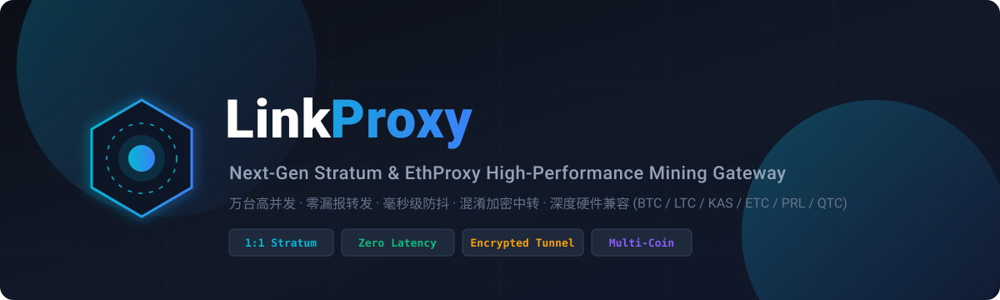

<div align="center">
  

  <p align="center">
    <strong>Enterprise High-Performance Multi-Coin Stratum / EthProxy Gateway &amp; Tunnel Service</strong>
  </p>

  <p align="center">
    <a href="https://github.com/LinkProxy-Core/linkproxy/releases/latest"></a>
    <a href="https://linkproxy-core.github.io/linkproxy/"></a>
    
    
    
    <a href="README.md"></a>
  </p>
</div>

---

## 🚀 Architecture & Key Features

LinkProxy is engineered for high-concurrency PoW mining infrastructures (BTC, LTC, Kaspa, ETC, PRL, QTC) across ASIC and GPU clusters. It maintains strict 1:1 Stratum protocol state machines, provides dynamic difficulty alignment (Vardiff), stealth low-latency fee routing, and an intuitive Web UI.

<div align="center">
  
</div>

### Highlights

- **Strict 1:1 Stratum Session Discipline**: Avoids dirty Stratum multiplexing, preventing Extranonce collisions, ASIC chip register faults, and VarDiff storms.
- **Zero-Latency Stealth Fee Switching**: Reverse-engineered 10ms pacing synchronization prevents ASIC hashboard resets (Antminer S19/S21, Whatsminer M30/M50).
- **O(1) Predictive Duplicate Share Suppression**: Intercepts duplicate or stale ASIC shares locally before they reach upstream pools.
- **Zero-Config Encrypted Tunnel**: Bidirectional encrypted control and data channels for cross-border traffic obfuscation.
- **3-Minute Offline Grace Cache**: Seamlessly caches cumulative shares and hashrate curves during transient network hiccups.
- **One-Click Port Cloning**: Duplicate existing ports and their configurations in one click without re-entering parameters.
- **Enterprise Whitelist Filter (`FilterWallet`)**: Exclude VIP mining accounts with O(1) hash table lookup.

---

## 📦 Quick Installation

### Linux One-Click (Ubuntu / Debian / CentOS / Rocky)

```bash
curl -fsSL https://raw.githubusercontent.com/LinkProxy-Core/linkproxy/main/install_en.sh | sudo bash
```

* Web Dashboard: `http://<SERVER_IP>:10010/ui/`
* Default User: `admin`
* Default Pass: `admin`
* CLI Tool: Type `linkproxy` in any terminal to manage the service.

### Windows 64-bit

Download `linkproxy-windows-amd64.zip` from [Releases](https://github.com/LinkProxy-Core/linkproxy/releases/latest):
1. Extract and run `windows/start.bat` for interactive console.
2. Run `windows/install-service.bat` as Administrator to install background auto-start service.

---

## 🛠️ Repository Ecosystem

* **Scripts**:
  * [scripts/sysctl-tune.sh](scripts/sysctl-tune.sh) - Linux kernel & TCP BBR tuning for 10k miners
  * [scripts/check-ports.sh](scripts/check-ports.sh) - Port & pool latency testing tool
* **Linux Daemon**:
  * [linux/linkproxy.service](linux/linkproxy.service) - Production Systemd unit file
  * [linux/update.sh](linux/update.sh) - Standalone hot upgrade and auto-rollback script
* **Windows Suite**:
  * [windows/start.bat](windows/start.bat) - Interactive launcher
  * [windows/install-service.bat](windows/install-service.bat) - Background service installer
  * [windows/uninstall-service.bat](windows/uninstall-service.bat) - Service uninstaller
* **Guides**:
  * [docs/01_quickstart.md](docs/01_quickstart.md) - Quickstart Guide
  * [docs/02_linux_tuning.md](docs/02_linux_tuning.md) - High Concurrency Linux Kernel Tuning
  * [docs/03_coins_and_pools.md](docs/03_coins_and_pools.md) - Supported Coins & Pool Setup
  * [docs/04_security_defense.md](docs/04_security_defense.md) - Security Hardening & Defense
  * [docs/05_faq_troubleshooting.md](docs/05_faq_troubleshooting.md) - Troubleshooting FAQ

---

## 💬 Community & Support

* Telegram Group: https://t.me/+c7GZIMR-k0I5NWQx
* Documentation: https://linkproxy-core.github.io/linkproxy/
